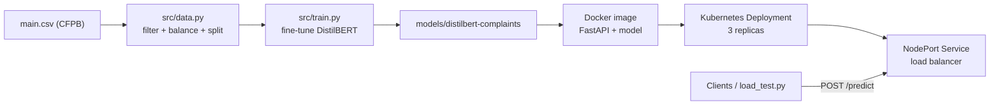

# Consumer Complaint Classifier

Sorts banking complaints into product categories (credit card, mortgage, debt collection, and so on) using a **fine-tuned DistilBERT** model. The model is **packaged in a Docker image** and **deployed on Kubernetes (Minikube)**, where several replicas sit behind one Service so the API can handle concurrent requests.

Data: [CFPB Consumer Complaint Database](https://www.consumerfinance.gov/data-research/consumer-complaints/), with complaints from 2015–2017 across 11 product classes.

---

## Why

Financial companies get thousands of complaints every day. Sending each one to the right team by hand is slow. This project reads the complaint text and predicts which **product** it is about, so routing can happen automatically.

> *"There is a collection account on my credit report that does not belong to me."* → **credit reporting**

## Results (test set: 10% held-out, stratified)

| Model | Accuracy | Weighted F1 |
|---|---|---|
| Baseline: frozen DistilBERT embeddings + Logistic Regression | 0.772 | – |
| **Fine-tuned DistilBERT** (3 epochs) | **0.867** | **0.864** |

Classes with very little data (`virtual currency`, `other financial service`) are still the hardest to predict.

---

## How it works



**Data pipeline** (`src/data.py`)
1. Keep 3 columns: date, product, complaint text.
2. Keep the 11 product categories used between 2015 and 2017.
3. Cap each class at 4,000 complaints so the large classes don't dominate.
4. Stratified 90/10 train/test split.

**Serving and concurrency**
- The model loads **once** when the container starts, not on every request.
- Kubernetes runs **3 pods**, and the Service spreads incoming requests across them, so 3 predictions run at the same time.
- Readiness probes keep traffic away from a pod until its model has loaded. Liveness probes restart a pod that stops responding.
- Need more throughput? Run `kubectl scale deployment complaint-api --replicas=5`.

---

## Project structure

```
consumer-complaint-classifier/
├── src/
│   ├── config.py      # paths, labels, hyper-parameters (edit settings here)
│   ├── data.py        # load -> filter -> balance -> split
│   ├── eda.py         # exploratory plots -> reports/figures/
│   ├── baseline.py    # DistilBERT embeddings + Logistic Regression
│   ├── train.py       # fine-tune DistilBERT, save to models/
│   └── evaluate.py    # metrics + confusion matrix
├── app/
│   └── main.py        # FastAPI service (/health, /predict)
├── k8s/
│   ├── deployment.yaml  # 3 replicas + health probes
│   └── service.yaml     # NodePort service (load balancing)
├── scripts/
│   └── load_test.py   # fire concurrent requests, report latency/throughput
├── notebooks/
│   └── original_analysis.ipynb  # original exploratory notebook
├── Dockerfile
├── requirements.txt      # full project
└── requirements-api.txt  # slim deps for the Docker image
```

---

## Quick start

### 1. Setup

```bash
git clone https://github.com/gargarnav0708/consumer-complaint-classifier.git
cd consumer-complaint-classifier
python -m venv .venv && source .venv/bin/activate
pip install -r requirements.txt
```

Download the complaints CSV from the [CFPB website](https://www.consumerfinance.gov/data-research/consumer-complaints/) (or the Kaggle mirror) and save it as `data/main.csv`.

### 2. Explore, train, and evaluate

```bash
python -m src.eda        # plots -> reports/figures/
python -m src.baseline   # optional: baseline model
python -m src.train      # fine-tune DistilBERT -> models/distilbert-complaints/
```

> Training is much faster on a GPU (for example Colab or Kaggle). If you train somewhere else, copy the `models/distilbert-complaints/` folder back into this repo before building the image.

### 3. Run the API locally

```bash
uvicorn app.main:app --port 8000
```

```bash
curl -X POST http://127.0.0.1:8000/predict \
     -H "Content-Type: application/json" \
     -d '{"text": "A debt collector calls me every day about a debt I already paid."}'
# {"product":"debt collection","confidence":0.98,"served_by":"my-laptop"}
```

Interactive docs are at http://127.0.0.1:8000/docs.

### 4. Build the Docker image

```bash
docker build -t complaint-api:latest .
docker run -p 8000:8000 complaint-api:latest
```

### 5. Deploy on Kubernetes (Minikube)

```bash
minikube start --cpus 4 --memory 8g

# Build the image inside Minikube's Docker so the cluster can find it
eval $(minikube docker-env)
docker build -t complaint-api:latest .

kubectl apply -f k8s/
kubectl get pods -w          # wait until all 3 pods are READY 1/1

minikube service complaint-api --url   # prints the URL, e.g. http://127.0.0.1:54321
```

### 6. Load test (concurrent requests)

```bash
python scripts/load_test.py --url <URL-from-above> --requests 300 --concurrency 30
```

Example output (numbers depend on your machine):

```
Requests:     300 (30 at a time)
Throughput:   ...
Latency p50:  ...
Requests per pod:
  complaint-api-7d9f8-abcde: 101
  complaint-api-7d9f8-fghij: 100
  complaint-api-7d9f8-klmno: 99
```

The "requests per pod" count shows the Service spreading traffic across the replicas.

### Clean up

```bash
kubectl delete -f k8s/
minikube stop
```

---

## API

| Method | Path | Body | Response |
|---|---|---|---|
| GET | `/health` | – | `{"status": "ok"}` |
| POST | `/predict` | `{"text": "..."}` | `{"product": "...", "confidence": 0.97, "served_by": "<pod-name>"}` |

**Product classes:** bank account or service, credit card, credit reporting, debt collection, money transfers, mortgage, other financial service, payday loan, prepaid card, student loan, virtual currency.

## Tech stack

Python · PyTorch · Hugging Face Transformers · scikit-learn · pandas · FastAPI · Docker · Kubernetes (Minikube)
